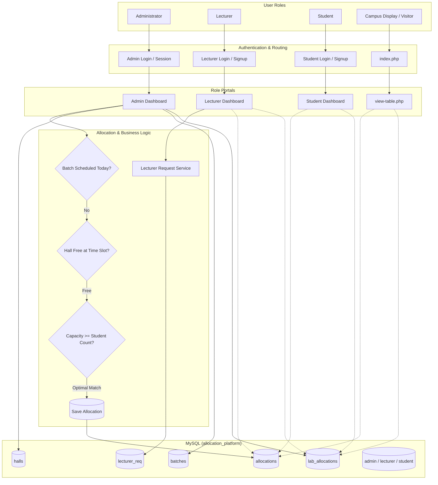
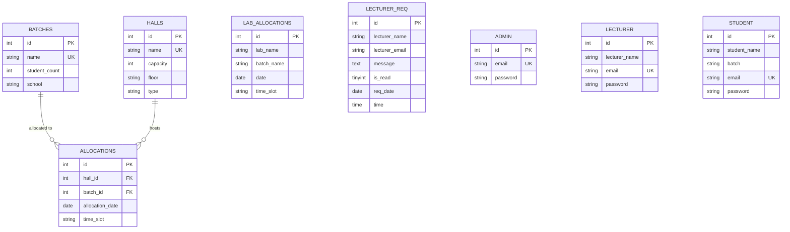

# 🏫 NIBM Hall & Lab Allocation Platform

<div align="center">


-purple?style=for-the-badge)


<br/>

[](https://www.php.net/)
[](https://www.mysql.com/)
[](https://getbootstrap.com/)
[](https://developer.mozilla.org/en-US/docs/Web/JavaScript)
[](https://datatables.net/)
[](https://sweetalert2.github.io/)

<p align="center">
  <b>An automated university lecture hall and laboratory allocation management platform engineered to eliminate scheduling clashes, optimize room capacity utilization, and streamline campus academic logistics.</b>
</p>

</div>

---

## 📌 Project Overview

The **NIBM Hall & Lab Allocation Platform** is my **1st Year Final Capstone Project** developed for the **Diploma in Computer System Design (DCSD)** program at the **National Institute of Business Management (NIBM)**.

In higher educational institutions with large student cohorts and shared campus resources, coordinating lecture halls and computing laboratories across departments (Computing, Business, Languages) presents significant logistical challenges. Manual scheduling frequently results in:
- **Double-booking collisions** for physical rooms during identical time windows.
- **Capacity mismatches**, such as placing a 60-student batch in a 35-seat hall.
- **Communication delays** between faculty members and campus administration regarding room requests.

This project solves these issues through a centralized, role-based web application with an automated allocation engine, real-time conflict checking, interactive administration dashboards, and dedicated access portals for administrators, lecturers, and students.

---

## 🎯 Key Capabilities & User Roles

### 🛠️ 1. Administrator Portal
* **Automated Hall Allocation Engine**: Automatically evaluates batch student headcount, filters available lecture halls on the designated date and time slot, and selects the optimal hall with sufficient capacity while preventing schedule clashes.
* **Computer Lab Allocation**: Dedicated interface to schedule specialized computer labs for practical batches.
* **Batch & Hall Management**: Full CRUD operations for campus batches (student count, faculty/school) and lecture spaces (capacity, floor, smart board availability).
* **Lecturer Request Mailbox**: Integrated in-app messaging system receiving direct requests from lecturers, featuring unread counters and AJAX status updates.
* **User Management**: Overview and directory management of registered lecturers and students.

### 👨‍🏫 2. Lecturer Portal
* **Daily Schedule Viewer**: Instant timetable lookup for allocated lecture halls and computer laboratories by date.
* **Lab & Room Inquiries**: Direct messaging pipeline to submit lab or special equipment requests to campus administrators.
* **Lecturer Profile**: Personal account overview with institutional identity details.

### 🎓 3. Student Portal
* **Personalized Timetable Access**: Fast, responsive lookup of daily lecture room and lab venues.
* **Batch-Aligned View**: Displays allocations relevant to student cohorts.
* **Account Dashboard**: Personal information and registered academic batch details.

### 🌐 4. Public Display & Campus Screen Viewer
* **Public Timetable Board (`view-table.php`)**: Standalone, read-only interface formatted for campus digital display boards to guide students and staff between lectures.
* **Domain Validation**: Signup forms enforce institutional email validation (`@nibm.lk` for faculty, `@student.nibm.lk` for undergraduates).

---

## 🏗️ System Architecture & Workflow



---

## 📊 Database Design

The database schema (`allocation_platform`) models halls, batches, allocations, users, and messaging:



---

## 💻 Tech Stack & Libraries

| Layer | Technologies Used | Description |
| :--- | :--- | :--- |
| **Backend** | PHP 7.4 / 8.x | Native server-side scripting with procedural MySQLi |
| **Database** | MySQL / MariaDB | Relational storage for campus records, timetables, and logs |
| **UI Framework** | Bootstrap 5, Cork Admin UI | Responsive theme with dark/light mode and modern dashboards |
| **Interactive Tables**| DataTables (jQuery plugin) | Sortable, searchable tabular views of rooms and allocations |
| **Calendar & Pickers**| Flatpickr | Lightweight JavaScript date selection component |
| **Alerts & Modals** | SweetAlert2 | User feedback alerts for CRUD operations and registration |
| **Icons & Fonts** | Feather Icons, Nunito (Google Fonts) | Modern iconography and typography |

---

## 📁 Repository Structure

```
├── index.php                          # Public portal & navigation gateway
├── admin-dashboard.php                # Admin master controller
├── lecturer-dashboard.php             # Lecturer master controller
├── student-dashboard.php              # Student master controller
├── view-table.php                     # Standalone public timetable viewer
├── database.sql                       # Complete schema & sample seed data
├── back/                              # Backend endpoints & database operations
│   ├── addbatches.php                 # Batch registration logic
│   ├── addhalls.php                   # Hall registration logic
│   ├── admin_login_back.php           # Admin login handler
│   ├── connection.php                 # MySQLi database connector
│   ├── delete-batch.php               # AJAX batch deletion endpoint
│   ├── delete-hall.php                # AJAX hall deletion endpoint
│   ├── delete-lecturer.php            # Lecturer deletion endpoint
│   ├── edit-batch.php                 # AJAX batch edit endpoint
│   ├── edit-hall.php                  # AJAX hall edit endpoint
│   ├── logout.php                     # Session termination script
│   ├── updatetablebatch.php           # Batch datatable & interactive edit modal
│   └── updatetablehall.php            # Hall datatable & interactive edit modal
├── includes/                          # Modular views, layouts, and components
│   ├── connection.php                 # Central DB configuration
│   ├── home-page-includes/            # Login, registration, and hero content
│   ├── admin-dashboard-includes/      # Allocation engine, mailbox, hall & batch managers
│   ├── lecturer-dashboard-includes/   # Lecturer schedule viewer and request panel
│   └── student-dashboard-includes/    # Student schedule viewer and profile panel
├── layouts/                           # Layout assets, theme loaders, and menu configs
└── src/                               # CSS, JS, vendor plugins, images, and fonts
```

---

## 🚀 Getting Started & Local Setup

Follow these steps to run the project locally on your machine using **XAMPP**, **WAMP**, or **LAMP**:

### Prerequisites
* [XAMPP](https://www.apachefriends.org/) (Apache + MySQL + PHP 7.4 or newer)
* Web browser (Chrome, Edge, Firefox)

### Step 1: Clone or Copy the Repository
Place the project folder inside your web server's root directory (`htdocs` for XAMPP):
```bash
# Example for XAMPP on Windows:
C:\xampp\htdocs\Hall_Allocation_Platform
```

### Step 2: Start Apache & MySQL
1. Open the **XAMPP Control Panel**.
2. Start both **Apache** and **MySQL** services.

### Step 3: Import the Database
1. Open your browser and navigate to `http://localhost/phpmyadmin`.
2. Click **New** in the left sidebar and create a database named:
   ```sql
   allocation_platform
   ```
3. Click on the newly created `allocation_platform` database.
4. Go to the **Import** tab at the top.
5. Click **Choose File**, select the [`database.sql`](database.sql) file included in this repository, and click **Import** (or **Go**).

### Step 4: Verify Database Connection
The project connects to MySQL using default XAMPP settings:
* **Host**: `localhost`
* **Username**: `root`
* **Password**: `""` (empty)
* **Database**: `allocation_platform`

*(If your local MySQL credentials differ, adjust [back/connection.php](back/connection.php) and [includes/connection.php](includes/connection.php) accordingly).*

### Step 5: Launch the Application
Open your browser and navigate to:
```
http://localhost/Hall_Allocation_Platform/
```

---

## 🔑 Default Credentials & Test Accounts

You can test the application immediately using the pre-seeded credentials or by registering a new account:

| Portal | URL | Email | Password |
| :--- | :--- | :--- | :--- |
| **Administrator** | `includes/home-page-includes/admin-login.php` | `admin@nibm.lk` | `admin123` |
| **Lecturer** | `includes/home-page-includes/lecturer-login.php` | *Register with any `@nibm.lk` email* | *Your password (min 8 chars)* |
| **Student** | `includes/home-page-includes/student-login.php` | *Register with any `@student.nibm.lk` email* | *Your password (min 8 chars)* |
| **Public Screen** | `view-table.php` | *No login required* | *Public viewer* |

---

## 💡 Key Highlights & Learning Outcomes

Building this project during my **1st year of the DCSD diploma** provided practical experience in:
- **Full-Stack Systems Integration**: Connecting front-end design with relational database architecture and server-side processing.
- **Relational Data Modeling**: Designing database schemas with foreign keys, constraints, and query joins to maintain data integrity.
- **Algorithm & Logic Design**: Constructing conflict-prevention algorithms with capacity-checking rules for timetable scheduling.
- **Asynchronous Front-End Communication**: Implementing AJAX calls to dynamically update tables and modals without reloading the page.
- **UI/UX Engineering**: Adapting an enterprise admin template (Cork) to create an intuitive dashboard experience across multiple user roles.

---

## 👨‍💻 Author

* **Developer**: Pawan
* **Academic Program**: Diploma in Computer System Design (DCSD) - 1st Year Final Project
* **Institution**: National Institute of Business Management (NIBM Kandy)

---

<div align="center">
  <sub>Built as an academic capstone project at NIBM. Designed for educational portfolio and demonstration purposes.</sub>
</div>
